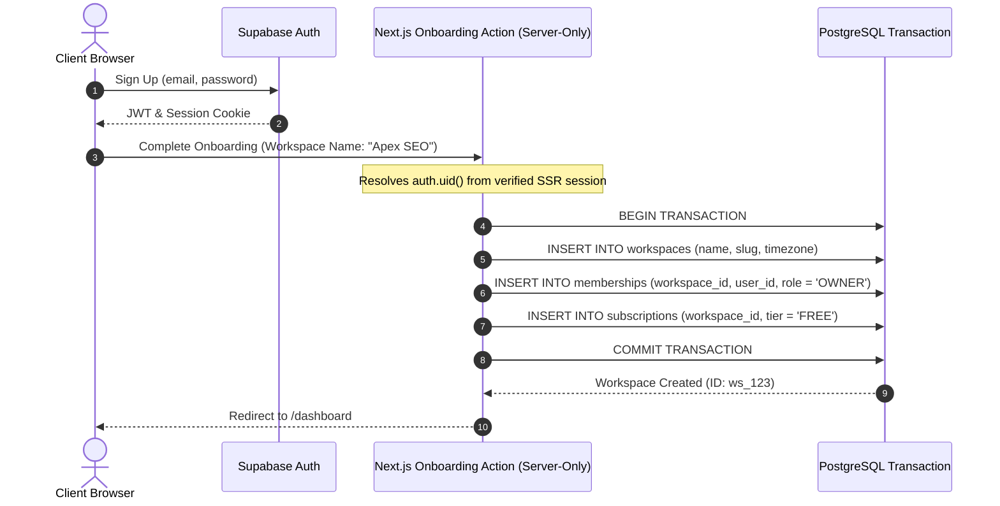

# LeadRescue — Database Design & Schema Migrations

> **Document Version**: 1.0.0  
> **Status**: Approved for Implementation (Phase 1)  
> **Target Database Engine**: PostgreSQL 15+ (Supabase)

---

## 1. Schema Architecture & Design Principles

1. **Strict Multi-Tenancy**: Every business table includes a `workspace_id UUID NOT NULL` column with a foreign key referencing `workspaces(id) ON DELETE CASCADE`.
2. **PostgreSQL Row Level Security (RLS)**: RLS is enabled on all tables as defense-in-depth behind application authorization.
3. **UTC Timestamps**: All temporal fields use `TIMESTAMPTZ` with default `timezone('utc'::text, now())`.
4. **Optimistic Locking**: Mutation-heavy tables (`leads`) include a `version integer NOT NULL DEFAULT 1` token.
5. **Transactional Consistency**: Lead mutations and activity logging are committed in the same database transaction.

---

## 2. Core DDL (Data Definition Language)

```sql
-- Enable necessary extensions
CREATE EXTENSION IF NOT EXISTS "uuid-ossp";
CREATE EXTENSION IF NOT EXISTS "pgcrypto";

-- Enum Types
CREATE TYPE user_role AS ENUM ('OWNER', 'ADMIN', 'MEMBER');
CREATE TYPE lead_stage AS ENUM ('NEW', 'CONTACTED', 'QUALIFIED', 'PROPOSAL', 'WON', 'LOST');
CREATE TYPE lead_activity_type AS ENUM ('NOTE_ADDED', 'STAGE_CHANGED', 'FOLLOW_UP_SCHEDULED', 'FOLLOW_UP_COMPLETED', 'REMINDER_SENT', 'IMPORTED');
CREATE TYPE reminder_status AS ENUM ('QUEUED', 'SENT', 'FAILED', 'CANCELLED');
CREATE TYPE import_status AS ENUM ('PENDING', 'PROCESSING', 'COMPLETED', 'FAILED');
CREATE TYPE duplicate_policy AS ENUM ('SKIP', 'UPDATE', 'CONFLICT_REPORT');
CREATE TYPE subscription_tier AS ENUM ('FREE', 'STARTER', 'AGENCY');
CREATE TYPE subscription_status AS ENUM ('TRIALING', 'ACTIVE', 'PAST_DUE', 'CANCELED');
CREATE TYPE outbox_status AS ENUM ('QUEUED', 'PROCESSING', 'COMPLETED', 'DEAD_LETTER');

-- ============================================================================
-- 1. WORKSPACES
-- ============================================================================
CREATE TABLE workspaces (
    id UUID PRIMARY KEY DEFAULT gen_random_uuid(),
    name VARCHAR(100) NOT NULL,
    slug VARCHAR(50) NOT NULL UNIQUE,
    timezone VARCHAR(50) NOT NULL DEFAULT 'UTC',
    created_at TIMESTAMPTZ NOT NULL DEFAULT timezone('utc'::text, now()),
    updated_at TIMESTAMPTZ NOT NULL DEFAULT timezone('utc'::text, now()),
    CONSTRAINT ck_workspace_slug CHECK (slug ~* '^[a-z0-9-]+$')
);

-- ============================================================================
-- 2. PROFILES (Mirrors auth.users)
-- ============================================================================
CREATE TABLE profiles (
    id UUID PRIMARY KEY REFERENCES auth.users(id) ON DELETE CASCADE,
    email VARCHAR(255) NOT NULL UNIQUE,
    full_name VARCHAR(100),
    avatar_url TEXT,
    created_at TIMESTAMPTZ NOT NULL DEFAULT timezone('utc'::text, now()),
    updated_at TIMESTAMPTZ NOT NULL DEFAULT timezone('utc'::text, now())
);

-- ============================================================================
-- 3. MEMBERSHIPS
-- ============================================================================
CREATE TABLE memberships (
    id UUID PRIMARY KEY DEFAULT gen_random_uuid(),
    workspace_id UUID NOT NULL REFERENCES workspaces(id) ON DELETE CASCADE,
    user_id UUID NOT NULL REFERENCES profiles(id) ON DELETE CASCADE,
    role user_role NOT NULL DEFAULT 'MEMBER',
    created_at TIMESTAMPTZ NOT NULL DEFAULT timezone('utc'::text, now()),
    updated_at TIMESTAMPTZ NOT NULL DEFAULT timezone('utc'::text, now()),
    CONSTRAINT uq_workspace_user UNIQUE (workspace_id, user_id)
);

-- ============================================================================
-- 4. LEADS
-- ============================================================================
CREATE TABLE leads (
    id UUID PRIMARY KEY DEFAULT gen_random_uuid(),
    workspace_id UUID NOT NULL REFERENCES workspaces(id) ON DELETE CASCADE,
    assigned_user_id UUID REFERENCES profiles(id) ON DELETE SET NULL,
    first_name VARCHAR(100) NOT NULL,
    last_name VARCHAR(100),
    email VARCHAR(255),
    phone VARCHAR(30),
    company_name VARCHAR(150),
    website VARCHAR(255),
    stage lead_stage NOT NULL DEFAULT 'NEW',
    source VARCHAR(50) DEFAULT 'manual',
    notes TEXT,
    last_contacted_at TIMESTAMPTZ,
    next_follow_up_at TIMESTAMPTZ,
    is_archived BOOLEAN NOT NULL DEFAULT false,
    version INTEGER NOT NULL DEFAULT 1,
    created_at TIMESTAMPTZ NOT NULL DEFAULT timezone('utc'::text, now()),
    updated_at TIMESTAMPTZ NOT NULL DEFAULT timezone('utc'::text, now()),
    CONSTRAINT ck_contact_present CHECK (email IS NOT NULL OR phone IS NOT NULL)
);

-- Case-insensitive unique active lead email within a workspace
CREATE UNIQUE INDEX uq_leads_workspace_email
ON leads (workspace_id, lower(trim(email)))
WHERE email IS NOT NULL AND is_archived = false;

-- ============================================================================
-- 5. LEAD ACTIVITIES
-- ============================================================================
CREATE TABLE lead_activities (
    id UUID PRIMARY KEY DEFAULT gen_random_uuid(),
    workspace_id UUID NOT NULL REFERENCES workspaces(id) ON DELETE CASCADE,
    lead_id UUID NOT NULL REFERENCES leads(id) ON DELETE CASCADE,
    user_id UUID REFERENCES profiles(id) ON DELETE SET NULL,
    type lead_activity_type NOT NULL,
    details JSONB NOT NULL DEFAULT '{}'::jsonb,
    created_at TIMESTAMPTZ NOT NULL DEFAULT timezone('utc'::text, now())
);

-- ============================================================================
-- 6. REMINDERS
-- ============================================================================
CREATE TABLE reminders (
    id UUID PRIMARY KEY DEFAULT gen_random_uuid(),
    workspace_id UUID NOT NULL REFERENCES workspaces(id) ON DELETE CASCADE,
    lead_id UUID NOT NULL REFERENCES leads(id) ON DELETE CASCADE,
    recipient_user_id UUID NOT NULL REFERENCES profiles(id) ON DELETE CASCADE,
    due_at TIMESTAMPTZ NOT NULL,
    status reminder_status NOT NULL DEFAULT 'QUEUED',
    idempotency_key VARCHAR(100) NOT NULL UNIQUE,
    sent_at TIMESTAMPTZ,
    error_message VARCHAR(500),
    created_at TIMESTAMPTZ NOT NULL DEFAULT timezone('utc'::text, now()),
    updated_at TIMESTAMPTZ NOT NULL DEFAULT timezone('utc'::text, now())
);

-- ============================================================================
-- 7. IMPORT JOBS & RESULTS
-- ============================================================================
CREATE TABLE import_jobs (
    id UUID PRIMARY KEY DEFAULT gen_random_uuid(),
    workspace_id UUID NOT NULL REFERENCES workspaces(id) ON DELETE CASCADE,
    user_id UUID NOT NULL REFERENCES profiles(id) ON DELETE CASCADE,
    file_name VARCHAR(255) NOT NULL,
    status import_status NOT NULL DEFAULT 'PENDING',
    total_rows INTEGER NOT NULL DEFAULT 0,
    processed_rows INTEGER NOT NULL DEFAULT 0,
    successful_rows INTEGER NOT NULL DEFAULT 0,
    failed_rows INTEGER NOT NULL DEFAULT 0,
    duplicate_policy duplicate_policy NOT NULL DEFAULT 'SKIP',
    created_at TIMESTAMPTZ NOT NULL DEFAULT timezone('utc'::text, now()),
    updated_at TIMESTAMPTZ NOT NULL DEFAULT timezone('utc'::text, now())
);

CREATE TABLE import_row_results (
    id UUID PRIMARY KEY DEFAULT gen_random_uuid(),
    import_job_id UUID NOT NULL REFERENCES import_jobs(id) ON DELETE CASCADE,
    row_number INTEGER NOT NULL,
    raw_data JSONB NOT NULL,
    error_message VARCHAR(500) NOT NULL,
    created_at TIMESTAMPTZ NOT NULL DEFAULT timezone('utc'::text, now())
);

-- ============================================================================
-- 8. SUBSCRIPTIONS & ENTITLEMENTS
-- ============================================================================
CREATE TABLE subscriptions (
    id UUID PRIMARY KEY DEFAULT gen_random_uuid(),
    workspace_id UUID NOT NULL UNIQUE REFERENCES workspaces(id) ON DELETE CASCADE,
    tier subscription_tier NOT NULL DEFAULT 'FREE',
    status subscription_status NOT NULL DEFAULT 'ACTIVE',
    max_active_leads INTEGER NOT NULL DEFAULT 100,
    max_members INTEGER NOT NULL DEFAULT 2,
    monthly_ai_drafts_quota INTEGER NOT NULL DEFAULT 20,
    ai_drafts_used INTEGER NOT NULL DEFAULT 0,
    current_period_start TIMESTAMPTZ NOT NULL DEFAULT timezone('utc'::text, now()),
    current_period_end TIMESTAMPTZ NOT NULL DEFAULT (timezone('utc'::text, now()) + interval '1 month'),
    external_customer_id VARCHAR(100) UNIQUE,
    external_subscription_id VARCHAR(100) UNIQUE,
    created_at TIMESTAMPTZ NOT NULL DEFAULT timezone('utc'::text, now()),
    updated_at TIMESTAMPTZ NOT NULL DEFAULT timezone('utc'::text, now())
);

-- ============================================================================
-- 9. TRANSACTIONAL OUTBOX / DURABLE JOBS
-- ============================================================================
CREATE TABLE outbox_events (
    id UUID PRIMARY KEY DEFAULT gen_random_uuid(),
    workspace_id UUID NOT NULL REFERENCES workspaces(id) ON DELETE CASCADE,
    job_type VARCHAR(50) NOT NULL,
    payload JSONB NOT NULL,
    status outbox_status NOT NULL DEFAULT 'QUEUED',
    attempts INTEGER NOT NULL DEFAULT 0,
    max_attempts INTEGER NOT NULL DEFAULT 5,
    available_at TIMESTAMPTZ NOT NULL DEFAULT timezone('utc'::text, now()),
    lease_token UUID,
    lease_expires_at TIMESTAMPTZ,
    last_error TEXT,
    created_at TIMESTAMPTZ NOT NULL DEFAULT timezone('utc'::text, now()),
    updated_at TIMESTAMPTZ NOT NULL DEFAULT timezone('utc'::text, now())
);
```

---

## 3. Query-Optimized Composite Indexes

| Index Name                    | Target Table      | Columns & Condition                                   | Performance Rationale                                                                                        |
| :---------------------------- | :---------------- | :---------------------------------------------------- | :----------------------------------------------------------------------------------------------------------- |
| `idx_leads_workspace_queue`   | `leads`           | `(workspace_id, is_archived, next_follow_up_at)`      | Accelerates the primary dashboard query ("Overdue", "Due Today", and "Upcoming" follow-up queues).           |
| `idx_leads_workspace_stage`   | `leads`           | `(workspace_id, is_archived, stage, created_at DESC)` | Accelerates stage-filtered lead lists and pipeline triage views.                                             |
| `idx_activities_lead_created` | `lead_activities` | `(lead_id, created_at DESC)`                          | Speeds up rendering of lead audit history and notes timeline.                                                |
| `idx_reminders_due_dispatch`  | `reminders`       | `(status, due_at)` WHERE `status = 'QUEUED'`          | Partial index used by the reminder cron job to rapidly find due notifications without scanning sent records. |
| `idx_outbox_unprocessed`      | `outbox_events`   | `(status, available_at)` WHERE `status = 'QUEUED'`    | Partial index allowing background workers to claim ready jobs with zero lock contention.                     |

---

## 4. Row Level Security (RLS) Policies

All tables enable RLS. Authorization helper functions are defined to check active workspace membership using the authenticated `auth.uid()`.

```sql
-- Helper function to check active workspace membership
CREATE OR REPLACE FUNCTION public.is_workspace_member(ws_id UUID)
RETURNS BOOLEAN
LANGUAGE sql
SECURITY DEFINER
STABLE
AS $$
  SELECT EXISTS (
    SELECT 1 FROM public.memberships
    WHERE workspace_id = ws_id
      AND user_id = auth.uid()
  );
$$;

-- Enable RLS across tenant-owned tables
ALTER TABLE workspaces ENABLE ROW LEVEL SECURITY;
ALTER TABLE memberships ENABLE ROW LEVEL SECURITY;
ALTER TABLE leads ENABLE ROW LEVEL SECURITY;
ALTER TABLE lead_activities ENABLE ROW LEVEL SECURITY;
ALTER TABLE reminders ENABLE ROW LEVEL SECURITY;
ALTER TABLE import_jobs ENABLE ROW LEVEL SECURITY;
ALTER TABLE import_row_results ENABLE ROW LEVEL SECURITY;
ALTER TABLE subscriptions ENABLE ROW LEVEL SECURITY;
ALTER TABLE outbox_events ENABLE ROW LEVEL SECURITY;

-- 1. Workspaces Policy
CREATE POLICY "Users can view workspaces they are members of"
ON workspaces FOR SELECT
USING (public.is_workspace_member(id));

-- 2. Leads Policies
CREATE POLICY "Workspace members can view leads"
ON leads FOR SELECT
USING (public.is_workspace_member(workspace_id));

CREATE POLICY "Workspace members can insert leads"
ON leads FOR INSERT
WITH CHECK (public.is_workspace_member(workspace_id));

CREATE POLICY "Workspace members can update leads"
ON leads FOR UPDATE
USING (public.is_workspace_member(workspace_id))
WITH CHECK (public.is_workspace_member(workspace_id));

CREATE POLICY "Admins and Owners can delete leads"
ON leads FOR DELETE
USING (
  EXISTS (
    SELECT 1 FROM public.memberships
    WHERE workspace_id = leads.workspace_id
      AND user_id = auth.uid()
      AND role IN ('OWNER', 'ADMIN')
  )
);
```

---

## 5. First Workspace & Membership Creation Strategy

When a user signs up via Supabase Auth, they do not yet belong to any workspace. To ensure transactional safety without exposing service-role keys to the browser:


