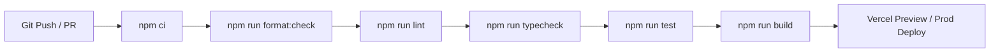

# LeadRescue — Deployment, CI/CD & Database Migration Runbook

> **Document Version**: 1.0.0  
> **Status**: Production Deployment Architecture (Phase 13)  
> **Target Hosting**: Vercel (Next.js App Router) & Supabase PostgreSQL (Managed Supavisor)

---

## 1. CI/CD Pipeline Architecture

LeadRescue enforces an automated zero-defect quality gate across all pull requests and merges to `main` via GitHub Actions (`.github/workflows/ci.yml`).



### 1.1 Automated Quality Gates

1. **Formatting**: Enforces Prettier code style without drift (`npm run format:check`).
2. **Linting**: Enforces strict Next.js, React 19, and ESLint rule sets with zero warnings (`npm run lint`).
3. **Type Safety**: Strictly validates TypeScript types with zero `any` leaks (`npm run typecheck`).
4. **Test Pyramid**: Runs 34+ test suites spanning unit, security, and end-to-end multi-tenant workflows (`npm run test`).
5. **Production Compilation**: Builds all 15 static, dynamic, and partial pre-render routes with Turbopack (`npm run build`).

---

## 2. Environments & Configuration Matrix

| Environment Variable                 | Staging (`staging`)                      | Production (`production`)            | Scope           |
| :----------------------------------- | :--------------------------------------- | :----------------------------------- | :-------------- |
| `NODE_ENV`                           | `production`                             | `production`                         | Server / Build  |
| `NEXT_PUBLIC_APP_URL`                | `https://staging.leadrescue.example.com` | `https://app.leadrescue.example.com` | Public / Client |
| `NEXT_PUBLIC_SUPABASE_URL`           | `https://[staging-ref].supabase.co`      | `https://[prod-ref].supabase.co`     | Public / Client |
| `NEXT_PUBLIC_SUPABASE_ANON_KEY`      | `eyJhbGci...` (Staging Anon Key)         | `eyJhbGci...` (Prod Anon Key)        | Public / Client |
| `SUPABASE_SERVICE_ROLE_KEY`          | `eyJhbGci...` (Staging Service Role)     | `eyJhbGci...` (Prod Service Role)    | **Server Only** |
| `DATABASE_URL`                       | Port 6543 (Staging Pooler)               | Port 6543 (Prod Pooler)              | **Server Only** |
| `STRIPE_SECRET_KEY`                  | `sk_test_...` (Staging Test Mode)        | `sk_live_...` (Production Live)      | **Server Only** |
| `STRIPE_WEBHOOK_SECRET`              | `whsec_test_...`                         | `whsec_live_...`                     | **Server Only** |
| `NEXT_PUBLIC_STRIPE_PUBLISHABLE_KEY` | `pk_test_...`                            | `pk_live_...`                        | Public / Client |
| `RESEND_API_KEY`                     | `re_test_...`                            | `re_live_...`                        | **Server Only** |
| `CRON_SECRET`                        | Strong random token                      | Strong random token                  | **Server Only** |

---

## 3. Database Migration Release Checklist

LeadRescue maintains strictly additive, backward-compatible migrations under `supabase/migrations/`.

### 3.1 Pre-Migration Verification

- [ ] Verify local schema passes syntax verification: `npm run test` includes `tests/migration*.test.ts`.
- [ ] Confirm the database connection string uses **Port 6543 (Transaction Pooler)** to prevent connection exhaustion.
- [ ] Verify whether the migration introduces a table lock (use `CONCURRENTLY` for index creations on large live tables).
- [ ] Take a manual point-in-time recovery backup snapshot in Supabase dashboard before applying schema changes.

### 3.2 Migration Execution Sequence

Migrations **MUST** be executed sequentially in numerical order:

```bash
# Apply migrations sequentially using Supabase CLI
supabase db push --include-all

# Or execute via psql using transactional connection string
psql "$DATABASE_URL" -f supabase/migrations/00001_initial_schema.sql
psql "$DATABASE_URL" -f supabase/migrations/00002_rbac_and_rls_policies.sql
psql "$DATABASE_URL" -f supabase/migrations/00003_csv_import_pipeline.sql
psql "$DATABASE_URL" -f supabase/migrations/00004_reminders_and_outbox.sql
psql "$DATABASE_URL" -f supabase/migrations/00005_subscriptions_and_ai_quotas.sql
psql "$DATABASE_URL" -f supabase/migrations/00006_performance_indexes_and_keyset.sql
```

### 3.3 Post-Migration Smoke Test

- [ ] Probe `/api/health` endpoint: Verify HTTP 200 with `status: "healthy"` and database `status: "up"`.
- [ ] Verify table permissions and RLS policies:
  ```sql
  SELECT tablename, rowsecurity FROM pg_tables WHERE schemaname = 'public';
  ```
- [ ] Verify all composite keyset indexes are active:
  ```sql
  SELECT indexname, tablename FROM pg_indexes WHERE schemaname = 'public' AND indexname LIKE 'idx_%';
  ```

---

## 4. Rollback Procedures & Down-Migration Scripts

If an incident occurs during or immediately following a deployment, execute the corresponding down-migration script in reverse order.

### Rollback: Migration 00006 (Performance Indexes)

```sql
-- Down-Migration: 00006
DROP INDEX IF EXISTS idx_outbox_lease_recovery;
DROP INDEX IF EXISTS idx_leads_search_lookup;
DROP INDEX IF EXISTS idx_leads_active_count;
DROP INDEX IF EXISTS idx_leads_keyset_stage;
DROP INDEX IF EXISTS idx_leads_keyset_follow_up;
```

### Rollback: Migration 00005 (Subscriptions & AI Quotas)

```sql
-- Down-Migration: 00005
DROP TABLE IF EXISTS public.ai_draft_quotas CASCADE;
DROP TABLE IF EXISTS public.stripe_events_processed CASCADE;
DROP TABLE IF EXISTS public.subscriptions CASCADE;
```

### Rollback: Migration 00004 (Reminders & Outbox Worker)

```sql
-- Down-Migration: 00004
DROP FUNCTION IF EXISTS public.claim_outbox_batch(INTEGER, INTEGER, TEXT);
DROP TABLE IF EXISTS public.outbox_events CASCADE;
DROP TABLE IF EXISTS public.reminders CASCADE;
```

### Rollback: Migration 00003 (CSV Import Pipeline)

```sql
-- Down-Migration: 00003
DROP TABLE IF EXISTS public.csv_import_jobs CASCADE;
```

### Rollback: Migration 00002 (RBAC & RLS Policies)

```sql
-- Down-Migration: 00002
DROP POLICY IF EXISTS "workspace_members_isolation" ON public.workspace_members;
DROP POLICY IF EXISTS "leads_workspace_isolation" ON public.leads;
DROP POLICY IF EXISTS "activity_logs_workspace_isolation" ON public.activity_logs;
DROP TABLE IF EXISTS public.workspace_members CASCADE;
```

### Rollback: Migration 00001 (Initial Schema)

```sql
-- Down-Migration: 00001
DROP TABLE IF EXISTS public.activity_logs CASCADE;
DROP TABLE IF EXISTS public.leads CASCADE;
DROP TABLE IF EXISTS public.profiles CASCADE;
DROP TABLE IF EXISTS public.workspaces CASCADE;
```

---

## 5. Deployment Verification & Rollback Triggers

### 5.1 Automated Rollback Triggers

Initiate immediate application rollback (revert to previous deployment commit on Vercel) if any of the following occur within 15 minutes of deployment:

1. **Health Check Failure**: `/api/health` returns HTTP 503 for $> 2$ consecutive minutes.
2. **Error Rate Spike**: Telemetry error rate exceeds 1% of incoming web requests.
3. **Dead-Letter Spikes**: Outbox dead-letter queue count exceeds 10 jobs.

### 5.2 Rollback Execution Steps

1. In Vercel Dashboard: Select the previous stable deployment and click **Promote to Production** (instant zero-downtime rollback).
2. If database schema is backwards-incompatible with previous release, execute the relevant down-migration SQL script in the Supabase administrative console.
3. Post incident status update on `#incidents-ops` per [`docs/disaster-recovery-runbook.md`](file:///Users/rao/.gemini/antigravity/scratch/leadrescue/docs/disaster-recovery-runbook.md).
