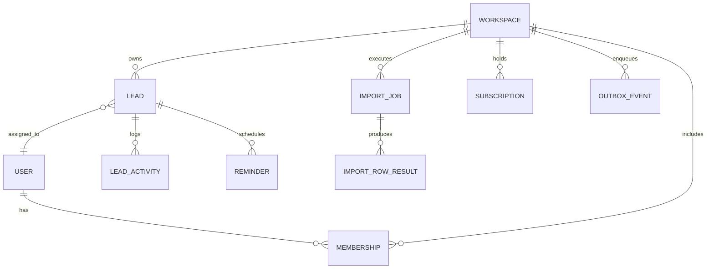

# LeadRescue — Domain Model & Business Invariants

> **Document Version**: 1.0.0  
> **Status**: Approved for Implementation (Phase 1)

---

## 1. Domain Entities & Invariants

All primary business entities use **UUIDv4** identifiers to prevent enumeration attacks and facilitate decentralized client-side ID generation where appropriate. All instants are represented in PostgreSQL as `TIMESTAMPTZ` (UTC).



---

### 1.1 User Profile (`users`)

- **Purpose**: Represents an authenticated individual. Managed by Supabase Auth (`auth.users`), mirrored in the application schema for profile metadata.
- **Fields**:
  - `id`: UUID (Primary Key, matches `auth.users.id`)
  - `email`: String (NOT NULL, unique, normalized lowercase)
  - `full_name`: String (NULLABLE, max 100 chars)
  - `avatar_url`: String (NULLABLE)
  - `created_at`: Timestamptz (NOT NULL, default `now()`)
  - `updated_at`: Timestamptz (NOT NULL, default `now()`)
- **Deletion Behavior**: If an `auth.users` row is deleted, the profile cascades.

### 1.2 Workspace (`workspaces`)

- **Purpose**: The multi-tenant isolation root. All leads, imports, reminders, and activities belong directly to a workspace.
- **Fields**:
  - `id`: UUID (Primary Key)
  - `name`: String (NOT NULL, 2–100 chars)
  - `slug`: String (NOT NULL, unique, 2–50 chars, regex `^[a-z0-9-]+$`)
  - `timezone`: String (NOT NULL, default `'UTC'`; valid IANA string e.g. `'America/Chicago'`)
  - `created_at`: Timestamptz (NOT NULL, default `now()`)
  - `updated_at`: Timestamptz (NOT NULL, default `now()`)
- **Invariants**: Workspaces cannot be deleted if active paying subscriptions exist. Deleting a workspace cascades deletion across all tenant data.

### 1.3 Membership (`memberships`)

- **Purpose**: Defines a user's role and access rights within a specific workspace.
- **Fields**:
  - `id`: UUID (Primary Key)
  - `workspace_id`: UUID (NOT NULL, FK $\rightarrow$ `workspaces.id` ON DELETE CASCADE)
  - `user_id`: UUID (NOT NULL, FK $\rightarrow$ `users.id` ON DELETE CASCADE)
  - `role`: Enum (`'OWNER'`, `'ADMIN'`, `'MEMBER'`, NOT NULL)
  - `created_at`: Timestamptz (NOT NULL, default `now()`)
  - `updated_at`: Timestamptz (NOT NULL, default `now()`)
- **Constraints**: `UNIQUE (workspace_id, user_id)`.
- **Invariants**: Every workspace must have at least one `OWNER`. An `OWNER` cannot leave or downgrade their role without transferring ownership.

### 1.4 Lead (`leads`)

- **Purpose**: The core prospect entity managed by an agency.
- **Fields**:
  - `id`: UUID (Primary Key)
  - `workspace_id`: UUID (NOT NULL, FK $\rightarrow$ `workspaces.id` ON DELETE CASCADE)
  - `assigned_user_id`: UUID (NULLABLE, FK $\rightarrow$ `users.id` ON DELETE SET NULL)
  - `first_name`: String (NOT NULL, 1–100 chars)
  - `last_name`: String (NULLABLE, max 100 chars)
  - `email`: String (NULLABLE, normalized lowercase, valid email format)
  - `phone`: String (NULLABLE, max 30 chars)
  - `company_name`: String (NULLABLE, max 150 chars)
  - `website`: String (NULLABLE, max 255 chars)
  - `stage`: Enum (`'NEW'`, `'CONTACTED'`, `'QUALIFIED'`, `'PROPOSAL'`, `'WON'`, `'LOST'`)
  - `source`: String (NULLABLE, max 50 chars; e.g. `'csv_import'`, `'outbound'`, `'referral'`)
  - `notes`: Text (NULLABLE, max 50,000 chars)
  - `last_contacted_at`: Timestamptz (NULLABLE)
  - `next_follow_up_at`: Timestamptz (NULLABLE)
  - `is_archived`: Boolean (NOT NULL, default `false`)
  - `version`: Integer (NOT NULL, default `1`; optimistic concurrency token)
  - `created_at`: Timestamptz (NOT NULL, default `now()`)
  - `updated_at`: Timestamptz (NOT NULL, default `now()`)
- **Constraints**:
  - `CHECK (email IS NOT NULL OR phone IS NOT NULL)` (Prevents phantom leads with no contact method).
  - `UNIQUE (workspace_id, email)` (Where `email IS NOT NULL AND is_archived = false`).

### 1.5 Lead Activity (`lead_activities`)

- **Purpose**: Immutable audit log of all events, notes, stage transitions, and reminders associated with a lead.
- **Fields**:
  - `id`: UUID (Primary Key)
  - `workspace_id`: UUID (NOT NULL, FK $\rightarrow$ `workspaces.id` ON DELETE CASCADE)
  - `lead_id`: UUID (NOT NULL, FK $\rightarrow$ `leads.id` ON DELETE CASCADE)
  - `user_id`: UUID (NULLABLE, FK $\rightarrow$ `users.id` ON DELETE SET NULL; NULL if automated system event)
  - `type`: Enum (`'NOTE_ADDED'`, `'STAGE_CHANGED'`, `'FOLLOW_UP_SCHEDULED'`, `'FOLLOW_UP_COMPLETED'`, `'REMINDER_SENT'`, `'IMPORTED'`)
  - `details`: JSONB (NOT NULL; structured payload e.g. `{"old_stage": "NEW", "new_stage": "CONTACTED"}`)
  - `created_at`: Timestamptz (NOT NULL, default `now()`)
- **Invariants**: Rows are strictly append-only. No updates or deletions allowed.

### 1.6 Follow-up / Reminder (`reminders`)

- **Purpose**: Represents a discrete, scheduled notification alert for an upcoming lead follow-up.
- **Fields**:
  - `id`: UUID (Primary Key)
  - `workspace_id`: UUID (NOT NULL, FK $\rightarrow$ `workspaces.id` ON DELETE CASCADE)
  - `lead_id`: UUID (NOT NULL, FK $\rightarrow$ `leads.id` ON DELETE CASCADE)
  - `recipient_user_id`: UUID (NOT NULL, FK $\rightarrow$ `users.id` ON DELETE CASCADE)
  - `due_at`: Timestamptz (NOT NULL; stored in UTC)
  - `status`: Enum (`'QUEUED'`, `'SENT'`, `'FAILED'`, `'CANCELLED'`)
  - `idempotency_key`: String (NOT NULL, unique; SHA-256 hash of `workspace_id + lead_id + due_at_iso`)
  - `sent_at`: Timestamptz (NULLABLE)
  - `error_message`: String (NULLABLE, max 500 chars)
  - `created_at`: Timestamptz (NOT NULL, default `now()`)
  - `updated_at`: Timestamptz (NOT NULL, default `now()`)
- **Constraints**: `UNIQUE (idempotency_key)`.

### 1.7 Import Job & Import Row Result (`import_jobs`, `import_row_results`)

- **Purpose**: Manages asynchronous, chunked CSV ingestion with per-row failure isolation.
- **Fields (`import_jobs`)**:
  - `id`: UUID (Primary Key)
  - `workspace_id`: UUID (NOT NULL, FK $\rightarrow$ `workspaces.id` ON DELETE CASCADE)
  - `user_id`: UUID (NOT NULL, FK $\rightarrow$ `users.id` ON DELETE CASCADE)
  - `file_name`: String (NOT NULL, max 255 chars)
  - `status`: Enum (`'PENDING'`, `'PROCESSING'`, `'COMPLETED'`, `'FAILED'`)
  - `total_rows`: Integer (NOT NULL, default 0)
  - `processed_rows`: Integer (NOT NULL, default 0)
  - `successful_rows`: Integer (NOT NULL, default 0)
  - `failed_rows`: Integer (NOT NULL, default 0)
  - `duplicate_policy`: Enum (`'SKIP'`, `'UPDATE'`, `'CONFLICT_REPORT'`)
  - `created_at`: Timestamptz (NOT NULL, default `now()`)
  - `updated_at`: Timestamptz (NOT NULL, default `now()`)
- **Fields (`import_row_results`)**:
  - `id`: UUID (Primary Key)
  - `import_job_id`: UUID (NOT NULL, FK $\rightarrow$ `import_jobs.id` ON DELETE CASCADE)
  - `row_number`: Integer (NOT NULL)
  - `raw_data`: JSONB (NOT NULL; contains original CSV row columns)
  - `error_message`: String (NOT NULL, max 500 chars)

### 1.8 Subscription & Entitlements (`subscriptions`)

- **Purpose**: Records current plan tier, status, and enforcement quotas for the workspace.
- **Fields**:
  - `id`: UUID (Primary Key)
  - `workspace_id`: UUID (NOT NULL, unique, FK $\rightarrow$ `workspaces.id` ON DELETE CASCADE)
  - `tier`: Enum (`'FREE'`, `'STARTER'`, `'AGENCY'`, NOT NULL, default `'FREE'`)
  - `status`: Enum (`'TRIALING'`, `'ACTIVE'`, `'PAST_DUE'`, `'CANCELED'`, NOT NULL, default `'ACTIVE'`)
  - `max_active_leads`: Integer (NOT NULL, default 100)
  - `max_members`: Integer (NOT NULL, default 2)
  - `monthly_ai_drafts_quota`: Integer (NOT NULL, default 20)
  - `ai_drafts_used_this_billing_period`: Integer (NOT NULL, default 0)
  - `current_period_start`: Timestamptz (NOT NULL)
  - `current_period_end`: Timestamptz (NOT NULL)
  - `external_customer_id`: String (NULLABLE, unique)
  - `external_subscription_id`: String (NULLABLE, unique)
  - `created_at`: Timestamptz (NOT NULL, default `now()`)
  - `updated_at`: Timestamptz (NOT NULL, default `now()`)

### 1.9 Outbox Event / Durable Job (`outbox_events`)

- **Purpose**: Reliable transactional messaging mechanism. Enqueued in the same database transaction as business mutations.
- **Fields**:
  - `id`: UUID (Primary Key)
  - `workspace_id`: UUID (NOT NULL, FK $\rightarrow$ `workspaces.id` ON DELETE CASCADE)
  - `job_type`: String (NOT NULL; e.g. `'SEND_REMINDER'`, `'PROCESS_CSV_CHUNK'`)
  - `payload`: JSONB (NOT NULL)
  - `status`: Enum (`'QUEUED'`, `'PROCESSING'`, `'COMPLETED'`, `'DEAD_LETTER'`)
  - `attempts`: Integer (NOT NULL, default 0)
  - `max_attempts`: Integer (NOT NULL, default 5)
  - `available_at`: Timestamptz (NOT NULL, default `now()`)
  - `lease_token`: UUID (NULLABLE; used for concurrency locking)
  - `lease_expires_at`: Timestamptz (NULLABLE)
  - `last_error`: Text (NULLABLE)
  - `created_at`: Timestamptz (NOT NULL, default `now()`)
  - `updated_at`: Timestamptz (NOT NULL, default `now()`)

---

## 2. Business Invariants & Lifecycle Edge Cases

### 2.1 Contacts Without Email

- A lead **must** have either a valid `email` or a `phone`.
- If a lead has no email, reminder notifications are sent via in-app banner/dashboard alert to the assigned agency member; email reminder jobs for that lead are skipped gracefully without error.

### 2.2 Duplicate Contacts

- Duplicate detection is evaluated on `(workspace_id, lower(trim(email)))`.
- When an existing active lead matches:
  - **Manual UI Creation**: Form rejects with `409 Conflict` and a direct link to view the existing lead.
  - **CSV Ingestion**: Respects selected policy:
    - `SKIP`: Discard row, increment `skipped_rows` count.
    - `UPDATE`: Overwrite specified non-blank fields (e.g. update `phone`, `notes`, `next_follow_up_at`), keeping original `created_at` and `stage`.
    - `CONFLICT_REPORT`: Flag row in `import_row_results` for manual resolution.

### 2.3 Leads With No Follow-up Date

- Leads can exist with `next_follow_up_at = NULL`.
- In the dashboard, these appear in a dedicated **"Needs Attention / Unscheduled"** queue to ensure no lead is forgotten.

### 2.4 Won or Lost Leads with Pending Reminders

- When a lead transitions to `WON` or `LOST`:
  - A database trigger or application transaction executes:
    ```sql
    UPDATE reminders
    SET status = 'CANCELLED'
    WHERE lead_id = $1 AND status = 'QUEUED';
    ```
  - This prevents stale reminders from firing for deals already closed or dropped.

### 2.5 Archived & Deleted Leads

- **Archival**: Sets `is_archived = true`. Archived leads are excluded from active list queries, overdue counters, and reminder dispatchers. They can be un-archived at any time.
- **Deletion**: Requires `ADMIN` or `OWNER` permission. Leads are permanently deleted via database CASCADE, which cleans up `lead_activities` and `reminders`.

### 2.6 Concurrent Updates & Optimistic Locking

- The `leads` table maintains an integer `version` column.
- Update queries enforce:
  ```sql
  UPDATE leads
  SET stage = $new_stage, version = version + 1, updated_at = now()
  WHERE id = $lead_id AND version = $expected_version;
  ```
- If 0 rows are affected, the application returns `409 Conflict` ("The lead was updated by another team member. Please refresh to see the latest changes.").

---

## 3. Timezone & Daylight Saving Time (DST) Handling

1. **Storage**: All timestamps (`next_follow_up_at`, `due_at`, `created_at`) are strictly stored in PostgreSQL as `TIMESTAMPTZ` normalized to UTC.
2. **Display**: The workspace defines a standard IANA timezone (e.g., `Europe/London`, `America/New_York`).
3. **"Due Today" Definition**:
   - A lead is "Due Today" when its `next_follow_up_at` falls between `00:00:00` and `23:59:59` in the **workspace's local timezone**.
   - Query calculation:
     ```sql
     next_follow_up_at >= (date_trunc('day', now() AT TIME ZONE ws.timezone) AT TIME ZONE ws.timezone)
     AND next_follow_up_at < ((date_trunc('day', now() AT TIME ZONE ws.timezone) + interval '1 day') AT TIME ZONE ws.timezone)
     ```
4. **DST Transitions**: By using standard IANA identifiers rather than static UTC offsets (e.g., `-05:00`), PostgreSQL and date libraries (`date-fns-tz`) automatically handle spring-forward and fall-back clock shifts correctly.
