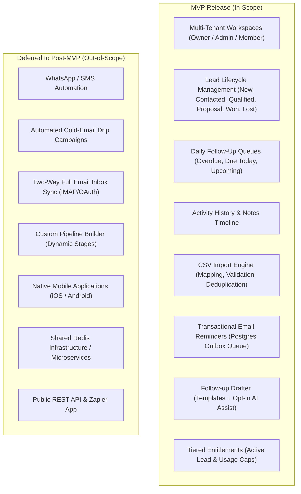
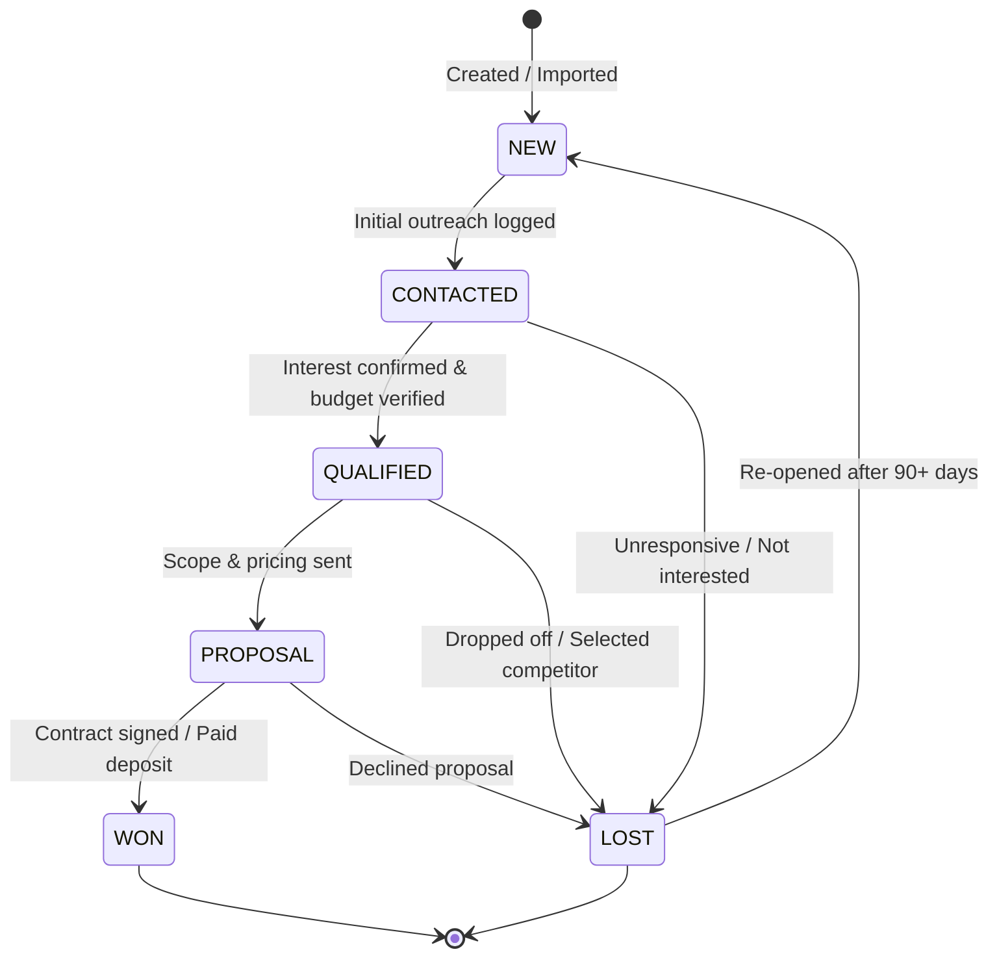

# LeadRescue — Product Specification (MVP)

> **Document Version**: 1.0.0  
> **Status**: Approved for Implementation (Phase 1)  
> **Author**: Lead Software Architect

---

## 1. Executive Summary & Value Proposition

**LeadRescue** is an opinionated, high-velocity lead follow-up engine designed specifically for small digital agencies (web design, SEO, and lead-generation firms).

Many boutique agencies manage their prospective clients across spreadsheets, disorganized inboxes, or bloated enterprise CRMs where deals silently slip through the cracks. LeadRescue provides a lightweight, focused **action layer**:

> _"Know which leads need attention today, and prepare the next follow-up in minutes."_

LeadRescue is not an all-in-one bloated CRM. It is a targeted workflow tool focused squarely on **timely follow-ups, lead qualification, and deal closing**.

---

## 2. Target Personas & Primary Use Cases

| Persona                        | Agency Model                        | Primary Pain Point                                                                            | Core Jobs to Be Done (JTBD)                                                                                                                             |
| :----------------------------- | :---------------------------------- | :-------------------------------------------------------------------------------------------- | :------------------------------------------------------------------------------------------------------------------------------------------------------ |
| **Agency Founder / Principal** | 2–10 person Web Design / SEO Agency | Lost revenue from forgotten discovery calls and stalled quotes.                               | Quickly see team pipeline health, ensure every prospect has an active next step, review won/lost outcomes.                                              |
| **Lead Generation Specialist** | B2B Prospecting / Outbound Agency   | Ingests batches of 200–2,000 scraped or enriched leads via CSV; loses track of who responded. | Import cleanly with duplicate detection, triage cold responses into New/Contacted, schedule systematic follow-ups.                                      |
| **Account Executive / Closer** | Digital Marketing Consultant        | Time spent writing repetitive follow-up emails instead of closing.                            | Review the daily "Due Today" queue, draft personalized follow-ups with one click (via deterministic templates or AI assist), log notes, advance stages. |

---

## 3. Scope Boundaries: MVP vs. Deferred Features



### 3.1 In-Scope (MVP Must-Haves)

1. **Authentication & Multi-Tenancy**: Email/password signup, password reset via Supabase Auth, workspace creation, membership invitations (Owner, Admin, Member), strict tenant data isolation.
2. **Lead Management**:
   - Fields: Name, Email, Phone, Company, Website, Stage, Source, Assigned Member, Next Follow-Up Date, Timezone, Notes.
   - Operations: Create, View, Update, Archive, Soft-delete.
   - Stage Machine: `NEW` $\rightarrow$ `CONTACTED` $\rightarrow$ `QUALIFIED` $\rightarrow$ `PROPOSAL` $\rightarrow$ `WON` / `LOST`.
3. **Follow-Up Action Queue**:
   - Categorized by: Overdue (past UTC date), Due Today (current workspace calendar day), Upcoming (future dates), No Follow-Up Set.
   - One-click actions: Complete follow-up (logs activity + prompts next date), Reschedule (+1 day, +3 days, +1 week, custom date).
4. **Activity Timeline**:
   - Automatic audit entries on stage changes.
   - Rich manual notes with author timestamp.
   - History of sent reminders and draft generation events.
5. **CSV Import Pipeline**:
   - Max 5,000 rows / 10MB per upload.
   - Interactive column mapping preview.
   - Pre-validation and row-level error reporting.
   - Duplicate detection on `(workspace_id, email)` with selectable policy: Skip, Update, or Report Conflict.
6. **Reminders & Postgres Outbox**:
   - Scheduled email reminders to lead owners for due follow-ups.
   - Durable PostgreSQL-backed job queue with exponential backoff and idempotency keys.
7. **Draft Generation**:
   - Instant boilerplate templates for common agency touchpoints (e.g., Post-audit check-in, Proposal follow-up, Re-engagement nudge).
   - Optional AI generation using structured inputs, with mandatory human review before sending (no automated autonomous emailing).
8. **Subscription Entitlements**:
   - Plan-based limits on active leads, members, AI drafts, and CSV imports.

---

## 4. Lead Lifecycle State Machine

A lead cannot exist in an arbitrary status string. All state changes must adhere to the validated lifecycle state machine:



### Stage Transition Rules

1. **Creation**: Every new lead enters `NEW` by default.
2. **Valid Progressions**:
   - `NEW` $\rightarrow$ `CONTACTED`, `LOST`
   - `CONTACTED` $\rightarrow$ `QUALIFIED`, `LOST`, `CONTACTED` (re-contacted)
   - `QUALIFIED` $\rightarrow$ `PROPOSAL`, `LOST`
   - `PROPOSAL` $\rightarrow$ `WON`, `LOST`
   - `LOST` $\rightarrow$ `NEW` (Re-activated prospect)
   - `WON` $\rightarrow$ Terminal state (can be transitioned to `NEW` if an upsell/renewal lead is explicitly re-opened).
3. **Invariants**:
   - Transitioning to `WON` or `LOST` automatically cancels any pending future reminders to prevent spamming staff.
   - Every stage change generates an immutable `lead_activities` record capturing old stage, new stage, user ID, and timestamp.

---

## 5. System Architecture Overview

```mermaid
graph TB
    subgraph Browser["Client Browser (Next.js App Router)"]
        UI["React 19 Components + Tailwind v4"]
        ClientForm["React Hook Form + Zod"]
    end

    subgraph Server["Next.js Server Runtime (Node.js)"]
        RouteAuth["Server Actions & API Routes"]
        TenantGuard["Tenant & RBAC Guard (Server-Side)"]
        DomainService["Domain Layer (Leads, Imports, Billing)"]
        OutboxQueue["Postgres Outbox Worker"]
    end

    subgraph DB["Supabase PostgreSQL 15+"]
        RLS["Row Level Security Policies"]
        Tables["Workspaces, Leads, Activities, Outbox"]
        Triggers["Timestamps & Audit Triggers"]
    end

    subgraph Integrations["External Services"]
        SupabaseAuth["Supabase Auth (JWT & Cookies)"]
        EmailProvider["Resend (Transactional Mail)"]
        AIProvider["AI Provider (Structured Drafts)"]
        BillingProvider["Stripe (Billing & Webhooks)"]
    end

    UI --> ClientForm
    ClientForm -->|HTTPS / Server Action| RouteAuth
    RouteAuth --> TenantGuard
    TenantGuard -->|Validates Membership| SupabaseAuth
    TenantGuard --> DomainService
    DomainService -->|Parameterized Query| RLS
    RLS --> Tables
    DomainService -->|Enqueue Jobs| OutboxQueue
    OutboxQueue -->|Dispatches Reminders| EmailProvider
    DomainService -->|Draft Request| AIProvider
    BillingProvider -->|Signed Webhooks (HMAC)| RouteAuth
```

---

## 6. Data Dictionary & Field Validation Summary

| Entity        | Field               | Type        | Required | Constraints / Validation                                       |
| :------------ | :------------------ | :---------- | :------- | :------------------------------------------------------------- |
| **Workspace** | `name`              | String      | Yes      | 2–100 chars, trimmed                                           |
| **Workspace** | `slug`              | String      | Yes      | Unique, lowercase alphanumeric + hyphen                        |
| **Workspace** | `timezone`          | String      | Yes      | Valid IANA timezone string (e.g. `America/New_York`)           |
| **Lead**      | `first_name`        | String      | Yes      | 1–100 chars                                                    |
| **Lead**      | `last_name`         | String      | No       | 0–100 chars                                                    |
| **Lead**      | `email`             | String      | No*      | Valid email syntax if provided; normalized to lowercase        |
| **Lead**      | `phone`             | String      | No*      | E.164 or sanitized phone string (max 30 chars)                 |
| **Lead**      | `company_name`      | String      | No       | 0–150 chars                                                    |
| **Lead**      | `website`           | String      | No       | Valid URL format (max 255 chars)                               |
| **Lead**      | `stage`             | Enum        | Yes      | `NEW`, `CONTACTED`, `QUALIFIED`, `PROPOSAL`, `WON`, `LOST`     |
| **Lead**      | `source`            | String      | No       | e.g., `referral`, `csv_import`, `cold_outreach` (max 50 chars) |
| **Lead**      | `next_follow_up_at` | Timestamptz | No       | Stored in UTC; must be future instant when set                 |
| **Lead**      | `is_archived`       | Boolean     | Yes      | Default `false`                                                |

_\* At least one of `email` or `phone` must be present when creating a lead manually._
