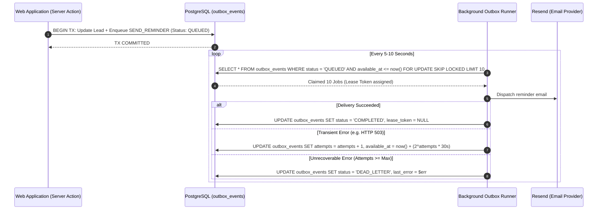

# LeadRescue — Scaling Architecture & Operational Engineering

> **Document Version**: 1.0.0  
> **Status**: Approved for Implementation (Phase 1)

---

## 1. Workload Assumptions & Capacity Targets (MVP)

- **Workspaces (Agencies)**: 100–500 active agencies.
- **Active Leads per Agency**: 100–2,500 leads.
- **Concurrent Users**: 50–200 concurrent web sessions.
- **Daily Follow-Up Reminders**: 1,000–5,000 outbound reminders per day.
- **CSV Ingestion**: Peak batch sizes of 1,000–5,000 rows.

**Key Latency Targets**:

- Dashboard Follow-Up Queue Query: **p95 < 120ms**
- Lead Detail & Activity Timeline View: **p95 < 80ms**
- CSV Import Batch Processing: **< 15 seconds** for 1,000 rows.

---

## 2. Database Performance & Query Optimization

### 2.1 Cursor vs. Offset Pagination

Offset pagination (`LIMIT 50 OFFSET 10000`) causes severe performance degradation on large tables because PostgreSQL must scan and discard thousands of rows.
LeadRescue uses **keyset / cursor-based pagination** for high-volume lead listings:

```sql
-- Optimal Keyset Query on composite index (workspace_id, is_archived, next_follow_up_at, id)
SELECT id, first_name, last_name, email, company_name, stage, next_follow_up_at
FROM leads
WHERE workspace_id = $1
  AND is_archived = false
  AND (next_follow_up_at, id) > ($last_seen_date, $last_seen_id)
ORDER BY next_follow_up_at ASC, id ASC
LIMIT 50;
```

### 2.2 Connection Pooling & Timeouts

- **Connection Pooler**: Supabase Supavisor / PgBouncer in **transaction mode** (port 6543) for Next.js Server Actions and Route Handlers to eliminate connection exhaustion under concurrency spikes.
- **Web Request Statement Timeout**: `statement_timeout = '3000ms'` (prevents runaway queries from consuming database CPU).
- **Background Worker Statement Timeout**: `statement_timeout = '30000ms'`.
- **Max Page Size**: Hard ceiling at 100 items per request; default 50.

---

## 3. Background Outbox Worker & Concurrency Control

Rather than introducing Redis or Kafka prematurely, LeadRescue uses PostgreSQL as the authoritative job store using the **SKIP LOCKED** concurrency pattern:



### 3.1 Lease-Lock Semantics

- When a worker claims a batch, it generates a unique `lease_token = gen_random_uuid()` and sets `lease_expires_at = now() + interval '2 minutes'`.
- If a worker crashes mid-execution, jobs whose lease has expired automatically become re-claimable by surviving workers without data loss.

---

## 4. Caching Rules & Tenant Isolation

1. **Strict Tenant Key Namespacing**: If caching is ever applied to read-heavy aggregates, cache keys **MUST** prefix the workspace ID:
   ```
   cache:workspace:{workspace_id}:pipeline_summary
   ```
2. **Prohibited Caching**:
   - **NEVER** cache sensitive PII lead records (names, emails, notes) in a shared cache.
   - **NEVER** share cached dashboard responses between different agency workspaces.
3. **HTTP Cache Headers**:
   - All authenticated application routes return:
     ```
     Cache-Control: private, no-cache, no-store, must-revalidate
     Pragma: no-cache
     ```

---

## 5. When to Introduce Redis (and When NOT To)

| Factor                 | Stay on PostgreSQL Outbox & Indexes                                        | Upgrade to Managed Redis (Upstash)                                                         |
| :--------------------- | :------------------------------------------------------------------------- | :----------------------------------------------------------------------------------------- |
| **Worker Concurrency** | Single or dual background worker instances processing < 100 jobs/sec.      | Multi-instance horizontally scaled workers processing > 500 jobs/sec with high contention. |
| **Rate Limiting**      | Database row checks or edge IP limiter adequate for single-region traffic. | Globally distributed multi-region rate limiting with atomic sliding windows.               |
| **Session & State**    | Supabase SSR cookie JWT verification (stateless).                          | Requirement for server-side revocable session stores or shared ephemeral pub/sub.          |

---

## 6. Observability, Logging & Incident Runbooks

### 6.1 Structured JSON Logging

Every log entry emits structured JSON containing:

- `timestamp`: ISO 8601 UTC
- `correlation_id`: Request correlation UUID passed across downstream calls
- `workspace_id`: Contextual agency identifier (if authenticated)
- `level`: `INFO`, `WARN`, `ERROR`
- `message`: Diagnostic text (strictly sanitized of passwords, auth tokens, and full customer contact details)

### 6.2 Incident Runbook Highlights

- **Database Outage / Unresponsive**: Next.js returns friendly 503 error page; outbox jobs stay queued safely on disk. Once PostgreSQL recovers, worker resumes draining backlog with exponential backoff.
- **Email Provider Outage (Resend)**: Outbox worker catches connection failures, increments attempt counter, applies jittered backoff, and alerts operations if dead-letter queue count exceeds 10 jobs.
- **Worker Backlog Spike**: Alert triggers if `unprocessed_queued_jobs > 200`. Action: Scale out worker process instances; PostgreSQL `SKIP LOCKED` handles concurrency safely across multiple runners.
