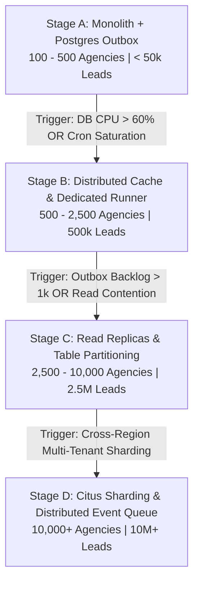

# LeadRescue — Scaling Roadmap & Engineering Evolution

> **Document Version**: 2.0.0  
> **Status**: Approved Scaling Architecture (Phase 14)  
> **Authoritative Scope**: Architecture transitions from Stage A (MVP) to Stage D (Hyper-Scale)

---

## 1. Executive Summary & Evolution Philosophy

LeadRescue is engineered following **pragmatic, milestone-driven architecture evolution**. Rather than introducing complex distributed systems (Kafka, Kubernetes, microservices) prematurely, the system uses high-performance PostgreSQL primitives (`FOR UPDATE SKIP LOCKED`, composite keyset indexes, Supavisor transaction pooler) with clear, documented trigger thresholds for upgrading infrastructure at each scale milestone.



---

## 2. Four Architectural Scaling Stages

### 2.1 Stage A — Monolithic App Router & PostgreSQL Outbox (Current Production MVP)

- **Target Capacity**:
  - 100–500 active agency workspaces.
  - 50,000 total active leads.
  - 1,000–5,000 daily follow-up reminders.
  - 50–200 concurrent web sessions.
- **Topology**:
  - **Web & API**: Next.js 16 App Router on Vercel Serverless.
  - **Database**: Supabase PostgreSQL (Micro / Small compute instance).
  - **Connection Pooler**: Supavisor in **Transaction Mode** on port `6543` (15 pool connections).
  - **Background Worker**: Vercel Cron triggering `/api/cron/outbox` every 1 minute with `claim_outbox_batch` RPC (`FOR UPDATE SKIP LOCKED`).
  - **Caching**: Node.js in-memory tenant cache (`src/lib/cache/tenant-cache.ts`) with strict tenant prefixing (`workspace:{ws}:category:{key}`) and 30-second TTL.
  - **Rate Limiting**: Sliding-window memory limiter (`src/lib/security/rate-limiter.ts`).
- **Operational Cost**: $\approx \$50 - \$120$ / month.

---

### 2.2 Stage B — Distributed Cache & Dedicated Background Runner

- **Target Capacity**:
  - 500–2,500 active agency workspaces.
  - 500,000 total active leads.
  - 25,000 daily follow-up reminders.
  - 500–1,500 concurrent web sessions.
- **Transition Triggers**:
  - Vercel Cron 1-minute execution duration exceeds 20 seconds.
  - Serverless cold-start variance affects webhook response times ($> 500\text{ms}$).
  - Multi-region edge traffic requires globally unified IP rate limiting.
- **Topology Upgrades**:
  - **Distributed Cache & Rate Limiting**: Introduce Upstash Redis. Replace in-memory rate limiter with Redis sliding-window counter (`UPSTASH_REDIS_REST_URL`).
  - **Dedicated Worker Runner**: Decouple outbox worker from Vercel Crons into a lightweight Node.js daemon (AWS ECS Fargate or Render Background Worker) running a continuous 5-second polling loop with graceful shutdown signal handling (`SIGTERM`).
  - **Database Compute**: Upgrade Supabase to 4-vCPU / 8GB RAM with 60 pool connections.
- **Operational Cost**: $\approx \$250 - \$600$ / month.

---

### 2.3 Stage C — Read Replicas & Time-Partitioned Outbox

- **Target Capacity**:
  - 2,500–10,000 active agency workspaces.
  - 2,500,000 total active leads.
  - 150,000 daily follow-up reminders.
  - 1,500–5,000 concurrent web sessions.
- **Transition Triggers**:
  - Analytical queries (pipeline aggregations, dashboard CSV export) create lock contention on the primary writer.
  - Outbox table exceeds 5,000,000 lifetime rows, increasing index maintenance overhead.
- **Topology Upgrades**:
  - **Read Replicas**: Provision read replica for dashboard read-only queries (`fetchWorkspaceLeadsKeyset`, export CSV). Direct writes and outbox claims strictly to the primary writer.
  - **Outbox Monthly Partitioning**: Partition `outbox_events` by range on `created_at`:
    ```sql
    CREATE TABLE outbox_events_2026_10 PARTITION OF outbox_events
    FOR VALUES FROM ('2026-10-01 00:00:00+00') TO ('2026-11-01 00:00:00+00');
    ```
    Archive and drop completed partitions older than 90 days.
  - **Horizontal Worker Fleet**: Scale background worker daemon to 3–5 parallel worker instances. PostgreSQL `FOR UPDATE SKIP LOCKED` guarantees zero duplicate claims across instances without coordination services.
- **Operational Cost**: $\approx \$800 - \$2,200$ / month.

---

### 2.4 Stage D — Multi-Tenant Citus Sharding & Distributed Event Queue

- **Target Capacity**:
  - 10,000+ active agency workspaces.
  - 10,000,000+ total active leads.
  - 500,000+ daily follow-up reminders.
  - 10,000+ concurrent web sessions.
- **Transition Triggers**:
  - Single PostgreSQL primary writer exceeds 80% sustained CPU or disk IOPS ceiling.
  - Cross-tenant data isolation and compliance require data locality in regional jurisdictions (US, EU, APAC).
- **Topology Upgrades**:
  - **Distributed Database Sharding**: Migrate to Azure Cosmos DB for PostgreSQL (Citus) or AWS Aurora with tenant sharding using `workspace_id` as the distribution column. Every tenant query routes to its specific database shard with zero cross-shard contention.
  - **Distributed Queue**: Transition background tasks from PostgreSQL outbox to AWS SQS FIFO or Temporal workflow orchestration for multi-step AI prospecting pipelines.
- **Operational Cost**: $\approx \$4,500+$ / month.

---

## 3. Connection Pooling Tuning Metrics & Formulas

PostgreSQL performance degrades when too many concurrent client connections contend for CPU cache and context-switching:

$$\text{Optimal Pool Size} = ((\text{CPU Cores} \times 2) + \text{Effective Spindle Count})$$

### 3.1 Supavisor Pooler Sizing Table

| Stage       | Database vCPU     | Max Direct Connections | Supavisor Pool (Transaction Mode) | Server Action Client Ceiling |
| :---------- | :---------------- | :--------------------- | :-------------------------------- | :--------------------------- |
| **Stage A** | 2 vCPU            | 60                     | 15                                | 300 concurrent requests      |
| **Stage B** | 4 vCPU            | 120                    | 45                                | 1,200 concurrent requests    |
| **Stage C** | 8 vCPU            | 250                    | 90 (Primary) + 90 (Replica)       | 4,000 concurrent requests    |
| **Stage D** | Multi-Node Shards | 500+                   | 150 per Shard                     | 15,000+ concurrent requests  |

### 3.2 Database Timeout Hardening Settings

```ini
# Enforce in postgresql.conf or Supabase DB settings
statement_timeout = '3000ms'                    # Fast-fail runaway web queries
idle_in_transaction_session_timeout = '10000ms' # Kill orphaned transactions
lock_timeout = '2000ms'                         # Prevent cascading lock waits
tcp_keepalives_idle = 60                        # Detect broken TCP connections fast
```

---

## 4. Horizontal Worker Decoupling Blueprint

When moving from Stage A to Stage B/C, extract the background runner into a dedicated container:

```typescript
// standalone-worker.ts (Stage B Runner Pattern)
import { createAdminSupabaseClient } from "./src/lib/supabase/admin";
import { runOutboxWorkerTick } from "./src/features/reminders/runner";
import { logger } from "./src/lib/security/logger";

let isShuttingDown = false;

process.on("SIGTERM", () => {
  logger.info("SIGTERM received. Finishing active jobs before exit...");
  isShuttingDown = true;
});

async function workerLoop() {
  const supabase = createAdminSupabaseClient();
  while (!isShuttingDown) {
    try {
      const result = await runOutboxWorkerTick({
        batchSize: 20,
        leaseSeconds: 120,
        supabaseClient: supabase!,
      });
      // Backoff sleep if no jobs were claimed
      const sleepMs = result.claimedCount === 0 ? 5000 : 500;
      await new Promise((resolve) => setTimeout(resolve, sleepMs));
    } catch (err) {
      logger.error("Unhandled worker loop error", { error: String(err) });
      await new Promise((resolve) => setTimeout(resolve, 5000));
    }
  }
  process.exit(0);
}

workerLoop();
```

---

## 5. Architectural Trigger & Metric Monitoring Matrix

| Metric                        | Target (Healthy) | Warning Threshold | Stage Transition Trigger   | Corrective Action                                                              |
| :---------------------------- | :--------------- | :---------------- | :------------------------- | :----------------------------------------------------------------------------- |
| **Dashboard Query p95**       | $< 80\text{ms}$  | $> 150\text{ms}$  | $> 250\text{ms}$ sustained | Check missing keyset indexes; route reads to Replica (Stage C)                 |
| **Database CPU %**            | $< 40\%$         | $> 65\%$          | $> 80\%$ sustained for 15m | Upgrade DB Compute; Introduce Upstash Redis cache (Stage B)                    |
| **Supavisor Waiting Clients** | $0$              | $> 5$             | $> 20$                     | Increase pool size or reduce statement timeout                                 |
| **Outbox Backlog Count**      | $< 50$ jobs      | $> 200$ jobs      | $> 1,000$ jobs             | Scale worker runner instances from 1 to 3 (Stage B/C)                          |
| **Dead-Letter Queue (DLQ)**   | $0$              | $> 5$             | $> 25$                     | Trigger SEV-2 alert; execute DLQ runbook (`docs/disaster-recovery-runbook.md`) |
